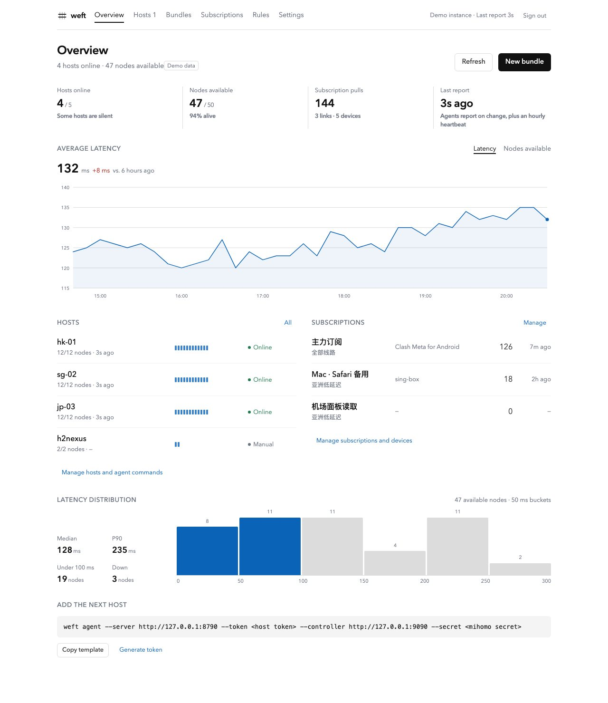
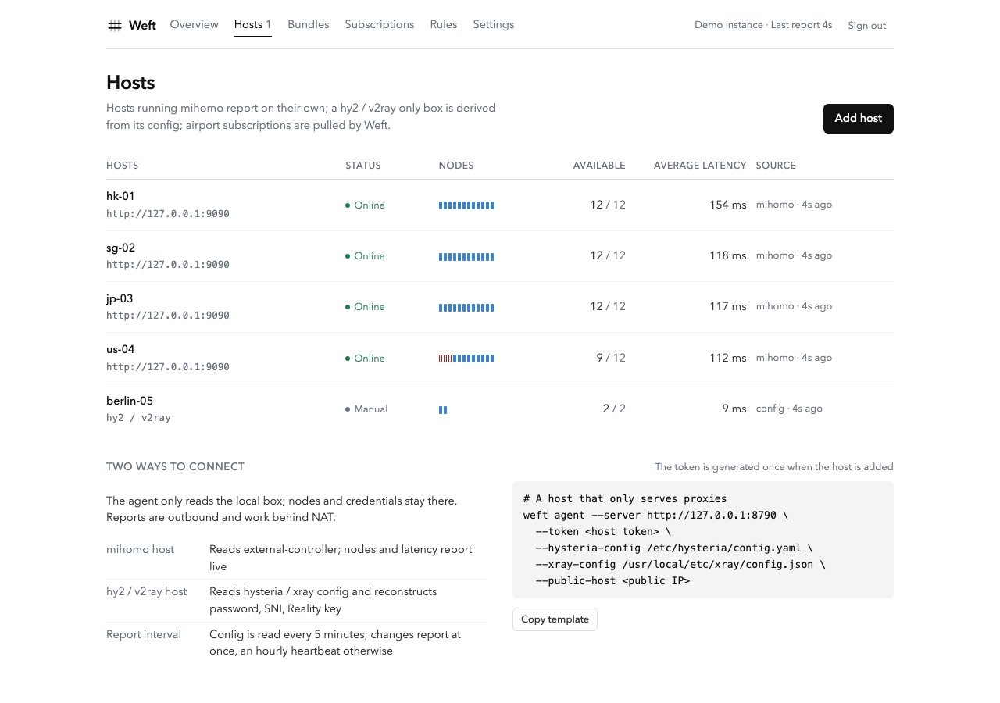
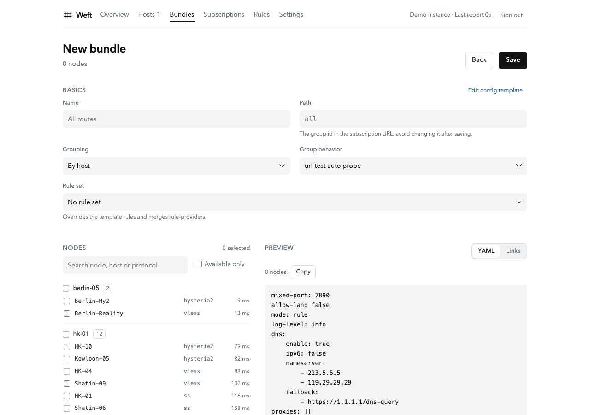
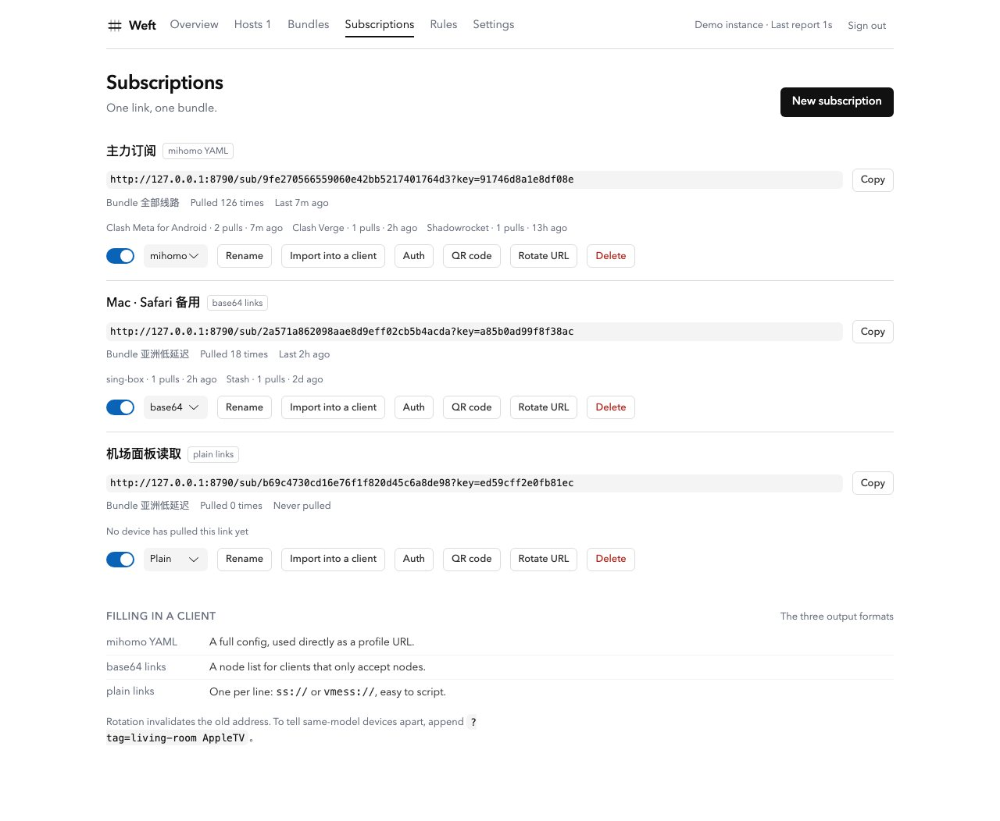
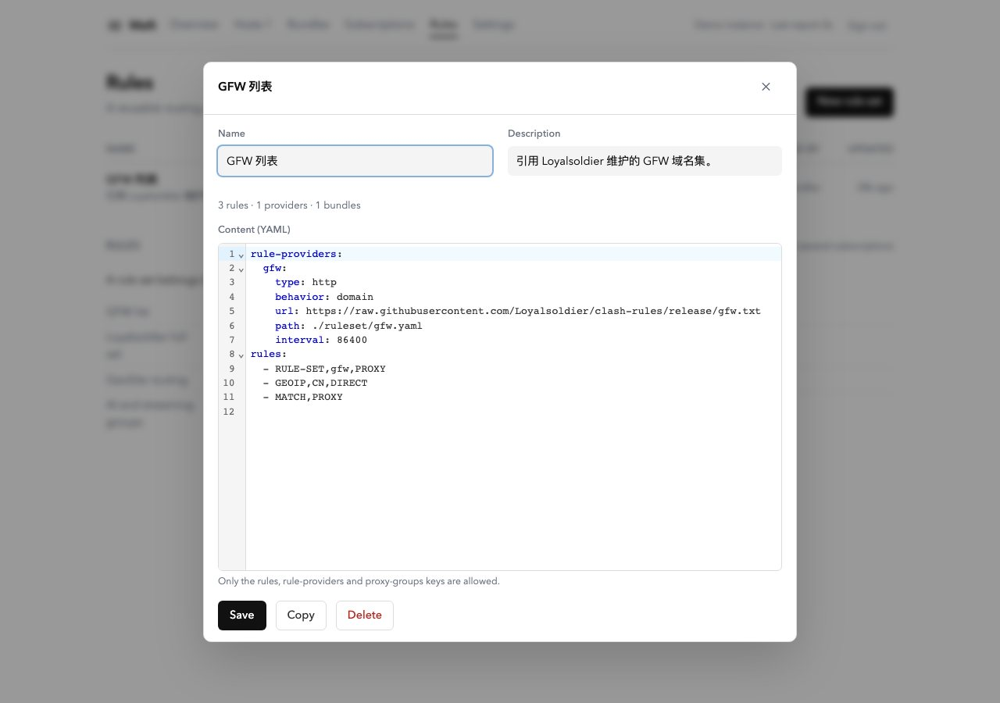
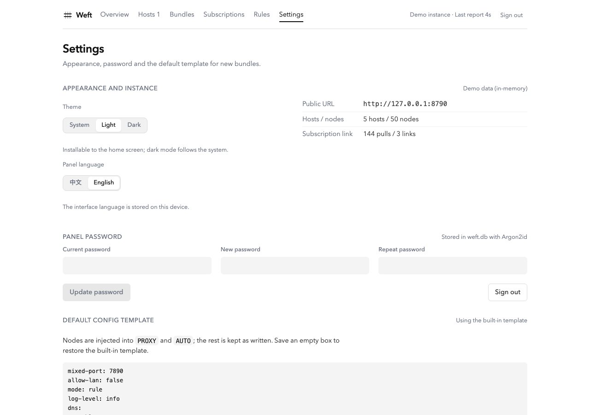
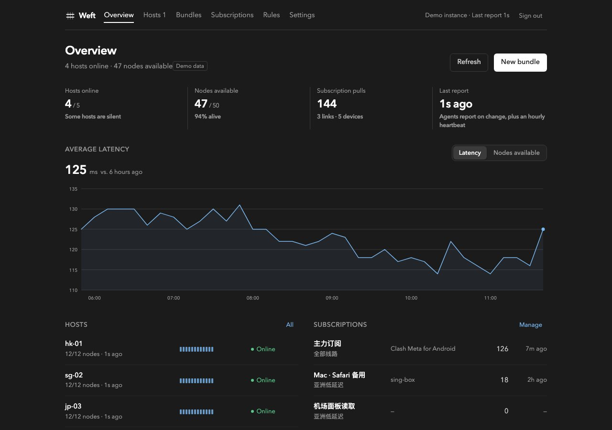
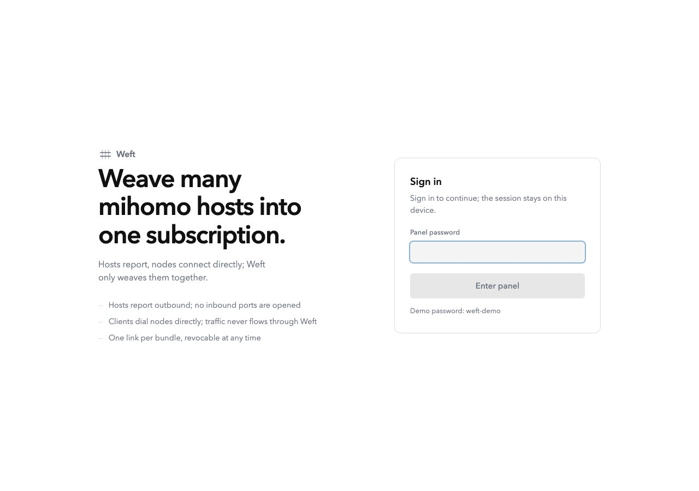
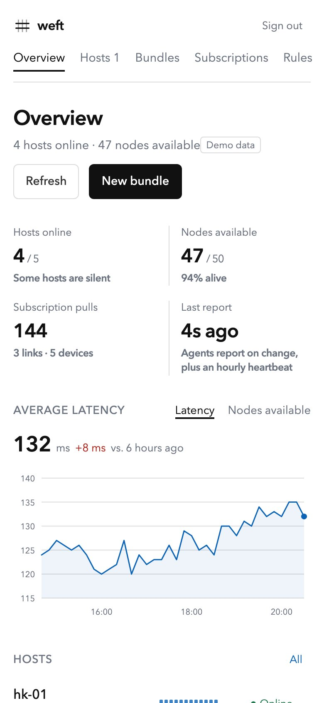

# Weft

Weave many hosts into one subscription.



Weft gathers proxy nodes from many machines — mihomo hosts, hy2/xray-only boxes, airport subscriptions and hand-entered links — and publishes them as one revocable subscription URL. Nodes stay independent, and traffic never passes through Weft.

## Features

- **Any host, no inbound ports** — a small agent reads local mihomo / hysteria2 / xray and reports outbound; works behind NAT.
- **Configs become nodes** — passwords, obfs, SNI and Reality keys are reconstructed from the server config; rotate on the box and the subscription follows.
- **Airport subscriptions** — Clash YAML, base64 and plain links; ad nodes and banners are dropped, names cleaned, and region kept for grouping.
- **One URL per bundle** — pick nodes across hosts, choose grouping and a rule profile, publish `/sub/<token>` as mihomo YAML, base64 or plain links. Revocable, with per-device access stats.
- **Rule profiles** — edit rules, rule-providers and proxy groups once, import gfwlist or rule sources, refresh with a diff, apply to any bundle.
- **Quiet panel** — water.css with Avenir Next, light and dark, mobile-first PWA, English and Chinese. Argon2id, CSRF, rate limits and security headers.

## Screens

All screenshots come from `weft serve --demo`; hosts, nodes, tokens and addresses are synthetic.

| Hosts | Bundle editor |
| --- | --- |
|  |  |
| **Subscriptions** | **Rules** |
|  |  |
| **Settings** | **Dark mode** |
|  |  |
| **Sign in** | **Phone** |
|  |  |

## Install

Download from [Releases](https://github.com/abcdlsj/weft/releases) or build:

```bash
make build && ./weft version
```

## Quick start

```bash
# demo fleet, password weft-demo
go run ./cmd/weft serve --demo --listen :8787

# production
./weft serve --listen :8787 --password '<password>'

# on a mihomo host
weft agent --server https://weft.example.com --token <token> \
  --controller http://127.0.0.1:9090 --secret <mihomo-secret>

# on a hy2 / xray host
weft agent --server https://weft.example.com --token <token> \
  --hysteria-config /etc/hysteria/config.yaml \
  --xray-config /usr/local/etc/xray/config.json --public-host 203.0.113.24
```

Open the panel, add a host, and run the printed agent command. The token is shown once.

## Status

v0.7.2 · Go + SQLite + React/TypeScript + water.css. Self-hosted and in daily use on a small fleet; the API may still change.

## License

MIT
