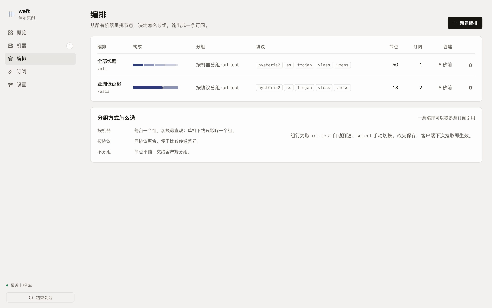

# weft

Weave many hosts into one subscription.

`weft` is a self-hosted control plane that gathers proxy nodes from many machines — machines running mihomo, machines that only serve hysteria2 or xray, and nodes you paste in by hand — and publishes them as a single, revocable subscription URL with a quiet web panel to manage it. Traffic never passes through weft: your devices still dial each node directly.

```
  host hk-01  (mihomo) ─┐
  host h2nexus (hy2/xray) ─┼─▶ weft ─▶ /sub/<token> ─▶ Clash Verge / sing-box / Shadowrocket
  hand-entered nodes  ─┘
```

## Why

Running proxies on several machines usually means several subscription URLs, drifting configs and no single place to see what is alive. weft keeps the hosts independent and does the joining on the server side.

## Features

- **Any host, with or without mihomo** — each host runs `weft agent`, which reads either the local mihomo external-controller or the machine's own hysteria2 / xray config, and pushes the result outbound. No inbound ports, no SSH credentials, works behind NAT.
- **Configs become nodes** — from `/etc/hysteria/config.yaml` and `/usr/local/etc/xray/config.json` the agent reconstructs the client side: password, obfs, certificate SNI, and Reality public keys (derived from the server's private key over X25519). Rotate a password on the box and the subscription follows.
- **Hand-entered nodes** — paste `hy2://`, `vless://`, `trojan://`, `ss://` or `vmess://` links, or fill a form. Manual nodes are never overwritten by a report.
- **One subscription URL per bundle** — pick nodes across hosts, get `/sub/<token>` in mihomo YAML, base64 or plain text. Tokens are revocable and track last use.
- **See which device pulls what** — the User-Agent becomes a client name (Clash Verge, sing-box, Shadowrocket, mihomo …), grouped per link with hit count, IP and last seen.
- **Rule templates** — keep the routing rules once, apply them to every bundle.
- **Panel** — live host status and latency, node picker, bundle editor, subscription management. Mobile first, installable as a PWA, tuned for Safari.
- **Demo mode** — `weft serve --demo` runs a fully populated instance with no agents.


| Bundles | Subscriptions | Phone |
| --- | --- | --- |
|  |  |  |

## Install

Grab the archive for your platform from [Releases](https://github.com/abcdlsj/weft/releases), or build it:

```bash
make build          # panel + binary, single file
./weft version
```

## Components

| Component | Where | What it does |
| --- | --- | --- |
| `weft serve` | `cmd/weft`, `internal/weft/server.go` | HTTP API, subscription endpoint, embedded panel, panel password and sessions |
| link parsing | `internal/weft/proxyparse.go` | share link → mihomo proxy map, used by both the API and the panel preview |
| `weft agent` | `cmd/weft`, `internal/weft/agent.go`, `mihomo.go`, `serviceconfig.go` | reads local sources and reports proxies outbound |
| store | `internal/weft/store.go` | SQLite: hosts, nodes, bundles, subscriptions, reports, access log, settings |
| subscription builder | `internal/weft/sub.go` | template-driven mihomo YAML, base64 and plain link lists |
| device naming | `internal/weft/device.go` | User-Agent to client name, IP, optional `?tag=` override |
| panel | `web/` | React + TypeScript SPA, five screens, dark mode, PWA, self-hosted fonts and icons |
| demo fleet | `internal/weft/seed.go` | `--demo` seeds hosts, nodes, bundles and a live ticker |
| icon generator | `tools/icons` | renders the PWA icons from the brand mark |
| CI + release | `.github/workflows/` | gofmt/vet/test/build on every push, archives on every `v*` tag |

## Quick start

```bash
# server + panel, seeded with a demo fleet (panel password: weft-demo)
go run ./cmd/weft serve --demo --listen :8787

# or build the binary with the panel embedded
make build && ./weft serve --listen :8787 --password '<your password>'

# on each host with mihomo running
weft agent --server https://weft.example.com --token <agent-token> \
  --controller http://127.0.0.1:9090 --secret <mihomo-secret>

# on a host that only serves hysteria2 / xray
weft agent --server https://weft.example.com --token <agent-token> \
  --hysteria-config /etc/hysteria/config.yaml \
  --xray-config /usr/local/etc/xray/config.json \
  --public-host 203.0.113.24
```

Open http://127.0.0.1:8787 and finish the setup wizard. The agent token is shown once, when you add the host.

## Status

Early. The design lives in [docs/DESIGN.md](docs/DESIGN.md).

## License

MIT
